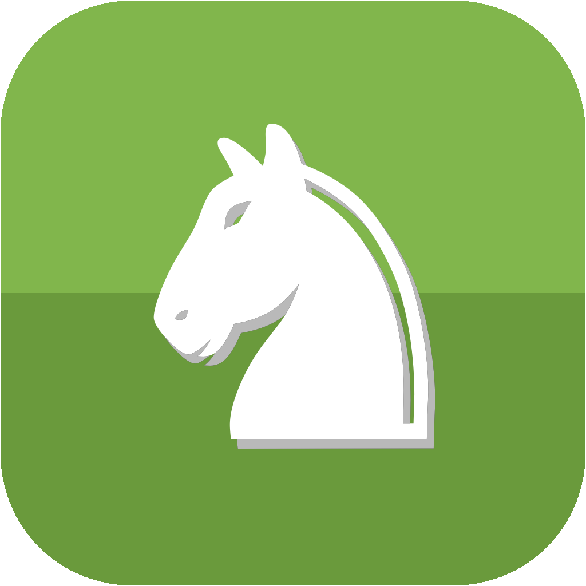

  

<h1 align="center">Multichess Releases</h1>

  Download page and update feed for <b>Multichess</b>, a desktop chess game-review trainer with Stockfish built in. 
  <a href="../../releases/latest"><b>Download the latest version</b></a>

---

## What is Multichess?

Multichess pulls your games from chess.com, reviews them with **Stockfish 19** on your own computer and turns your mistakes
into training. Nothing to install besides the app itself: the engine is inside.

- **Game review**: move-by-move classification (brilliant … blunder), accuracy, estimated game rating, time per move, best-move arrows
- **Puzzles from your own games**: Daily, Rush, Battle, Custom, spaced repetition
- **Insights**: openings, clock use, progress over time, a weekly plan
- **Play Stockfish** at several levels with live move feedback
- **Looks the way you like**: board themes, ten piece sets, photo backgrounds, English / Русский / O‘zbekcha
- **Private by design**: your games and reviews stay on your computer

## Download

| Platform | File | Requirements |
|---|---|---|
| Windows | `Multichess-Setup-<version>.exe` | Windows 10 / 11, 64-bit |
| macOS | `Multichess-<version>.dmg` | A recent macOS on Apple Silicon (M1 or newer) |

Get them from the [latest release](../../releases/latest). Linux is not available yet.

### Install

**Windows**: run the `.exe`. The app is not code-signed yet, so SmartScreen may say "unknown publisher":
click *More info → Run anyway*.

**macOS**: open the `.dmg` and drag Multichess to *Applications*. The first time, right-click the app and choose *Open*
(the app is not notarised yet).

## Updates

Multichess checks this repository when it starts and tells you when a newer version is out. Press **Update now** and it
downloads the new version, installs it and restarts, nothing to download by hand. You can also check at any time in
*Settings → Data → Updates*, or switch the automatic check off there.

The update feed is the pair of small files attached to every release: `latest.yml` (Windows) and `latest-mac.yml` (macOS),
each carrying the version, the installer name, its SHA-512 checksum and the release notes. The app verifies the checksum
before installing anything.

## Privacy

Everything runs locally. The app talks to the internet only to read **your public games from chess.com's published-data
API** and to **check this page for updates**. No account, no analytics, no tracking.

## Licence and source

Multichess is free software, released under the **GNU General Public License v3.0** (see [LICENSE](LICENSE)).
It bundles and builds on open-source components, listed with their licences in [THIRD_PARTY.md](THIRD_PARTY.md):
[Stockfish](https://stockfishchess.org) (GPL-3.0), [python-chess](https://github.com/niklasf/python-chess) (GPL-3.0),
piece sets from the [Lichess](https://github.com/lichess-org/lila) project, opening names from
[lichess-org/chess-openings](https://github.com/lichess-org/chess-openings) (CC0) and photographs from Wikimedia Commons.

The complete corresponding source code of any release is available on request: open an
[issue](../../issues/new) and it will be provided. This repository only distributes the finished apps.

## Feedback

Found a bug or have an idea? [Open an issue](../../issues/new).

---

Multichess is not affiliated with chess.com, Lichess or the Stockfish team.
